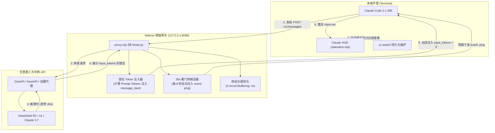

# Claude HUD Gateway 🚀

> **Claude Code 终端状态栏 (Claude HUD) 激活诊断、一键自愈与流式协议增强网关**  
> *Diagnostic, Self-Healing & Streaming Enhancement Gateway for Claude Code StatusLine (Claude HUD)*

[](https://opensource.org/licenses/MIT)
[](https://nodejs.org/)
[](https://github.com)
[-success.svg)](https://nodejs.org)

---

## 目录 (Table of Contents)
- [一、 项目定位与背景](#一-项目定位与背景)
- [二、 为什么你的 Claude HUD 会失效？(三大痛点逆向根因)](#二-为什么你的-claude-hud-会失效三大痛点逆向根因)
  - [痛点 1：终端底部完全一片空白（客户端配置丢失与覆写）](#痛点-1终端底部完全一片空白客户端配置丢失与覆写)
  - [痛点 2：HUD 出现但进度条永远死锁在 0%（流式用量断流）](#痛点-2hud-出现但进度条永远死锁在-0流式用量断流)
  - [痛点 3：Windows Git Bash 吞反斜杠与语法报错](#痛点-3windows-git-bash-吞反斜杠与语法报错)
  - [痛点 4：长思考模型 (DeepSeek-R1 / o1) 30s 崩溃断流](#痛点-4长思考模型-deepseek-r1--o1-30s-崩溃断流)
- [三、 系统全景架构](#三-系统全景架构)
- [四、 核心功能与工具链](#四-核心功能与工具链)
- [五、 快速上手 (Quick Start)](#五-快速上手-quick-start)
  - [1. 本地环境体检与一键自愈 (Doctor)](#1-本地环境体检与一键自愈-doctor)
  - [2. 中转 API 流式合规性探针 (Probe)](#2-中转-api-流式合规性探针-probe)
  - [3. 启动本地 Sidecar 网关 (Proxy)](#3-启动本地-sidecar-网关-proxy)
- [六、 Agent 技能集成 (Agent Skill)](#六-agent-技能集成-agent-skill)
- [七、 English Quickstart Guide](#七-english-quickstart-guide)
- [八、 深度技术文档索引](#八-深度技术文档索引)
- [九、 开源协议 (License)](#九-开源协议-license)

---

## 一、 项目定位与背景

[Claude Code](https://github.com/anthropics/claude-code) 拥有出色的终端交互体验，配合 [claude-hud](https://github.com/anthropics/claude-hud) 插件可以在终端底部实时展示当前会话的模型名、Token 消耗进度条以及额度状态：

```text
[Claude 3.7 Sonnet] ██████░░░░ 42% (200k) · 5h: 35% · 余额: $18.50
```

然而，在使用 `cc-switch` 切换第三方中转 API、自建反代（如 OneAPI / NewAPI）或在 Windows 环境下运行时，开发者普遍遭遇以下三类崩溃级问题：
1. **终端底部完全一片漆黑**，无论怎么重启 Claude Code 都不出现状态栏；
2. **状态栏虽然出现，但进度条永远是 `░░░░░░░░░░ 0%`**，无论输入多长的上下文都不增长；
3. **在 Windows 环境下运行时报错**，例如反斜杠被吞、或者报 `'cols=$(stty'` 语法错误；
4. **接入长思考模型（如 DeepSeek-R1、o1）时**，模型思考超过 30 秒客户端直接抛出 `Streaming idle timeout` 崩溃。

**claude-hud-gateway** 汇集了对 Claude Code 2.1.295 与 Claude HUD 0.10.0 的全套底层逆向结论，提供**开箱即用的一键自愈工具**、**API 流式探针**以及**零外部依赖的本地 Sidecar 增强网关**，彻底解决以上所有顽疾。

---

## 二、 为什么你的 Claude HUD 会失效？(三大痛点逆向根因)

### 痛点 1：终端底部完全一片空白（客户端配置丢失与覆写）
- **现象**：终端底部没有任何输出，连灰色的空进度条都没有。
- **逆向分析**：
  - Claude Code 在 `Qir` 函数中检查 `~/.claude/settings.json` 的 `statusLine` 配置，若不存在直接跳过执行。
  - `cc-switch` 每次切换 Provider 时，原理是**全量覆写** `~/.claude/settings.json`。
  - 大量在 `cc-switch.db` 中保存的供应商档案（如官方、第三方中转）缺少 `statusLine` 字段。一旦切换，原先安装好的 HUD 配置会被连根拔起抹除！

### 痛点 2：HUD 出现但进度条永远死锁在 0%（流式用量断流）
- **现象**：终端底部出现了 `[Claude 3.7 Sonnet] ░░░░░░░░░░ 0%`，但数字永远不涨。
- **逆向分析**：
  - 在 `claude.exe` 的流累加器函数 `the(oldUsage, newUsage)` 中，存在极其严苛的守卫：
    ```javascript
    input_tokens: newUsage.input_tokens !== null && newUsage.input_tokens > 0 
      ? newUsage.input_tokens 
      : oldUsage.input_tokens
    ```
  - 第三方中转为了兼容 OpenAI 格式（`/chat/completions`），在流式首包 `message_start` 中**根本没有提供 `input_tokens`，或者粗暴返回了 `"input_tokens": 0`**。
  - 由于 `0 > 0` 为假，Claude Code 累加器直接拒绝更新，会话全程保持 `input_tokens = 0`。
  - 传给状态栏插件时 `used_percentage = 0`，最终只能渲染灰色空条！

### 痛点 3：Windows Git Bash 吞反斜杠与语法报错
- **现象**：报找不到路径，或者报 `cols=$(stty size...` 语法错误。
- **逆向分析**：
  - Claude Code 在 Windows 上通过 `Z8()` 自动探测是否安装了 Git for Windows。
  - **安装了 Git Bash**：默认调用 `bash.exe -c "<command>"`。如果配置里写了 Windows 反斜杠路径（如 `C:\Users\...`），Bash 会把 `\` 当作转义符吞掉，导致路径断裂！
  - **未安装 Git Bash**：默认调用 `powershell.exe -Command "<command>"`。而 `claude-hud` 默认安装的命令是类 Unix Shell 脚本（`cols=$(stty size...); exec node ...`），PowerShell 解析立刻触发语法错误崩溃！

### 痛点 4：长思考模型 (DeepSeek-R1 / o1) 30s 崩溃断流
- **现象**：模型思考超过 30 秒，客户端报错 `Streaming idle timeout: No data received within 30000ms`。
- **逆向分析**：
  - Claude Code 内部硬编码了 30 秒空闲看门狗（`Jk = 30000`）。长推理模型思考阶段未吐文字 chunk 时，客户端判定为僵死强行掐断流。

---

## 三、 系统全景架构



---

## 四、 核心功能与工具链

| 工具模块 | 路径 | 核心能力 |
| :--- | :--- | :--- |
| **全能环境体检官** | `skills/claude-hud-doctor/scripts/doctor.mjs` | 扫描 `settings.json`、检测 Git Bash / PowerShell 兼容性、扫描 `cc-switch.db` 供应商档案，支持 `--fix` 一键自愈。 |
| **API 流式合规探针** | `skills/claude-hud-doctor/scripts/probe_api.mjs` | 发送流式探针请求，精确解析首帧 SSE 数据，判定 API 是否包含 `usage.input_tokens > 0`，给出 PASS/FAIL 裁决。 |
| **Sidecar 增强网关** | `proxy/proxy.mjs` | 纯 Node.js 高性能透明代理。**自动为首包注入 Token**（点亮进度条）、**长思考每 8s 发送心跳**（防 30s 崩溃）、**规范响应头**。 |
| **Agent Skill 技能包** | `skills/claude-hud-doctor/SKILL.md` | 符合标准 Agent 规范，供 Claude Code、Cursor、Gemini CLI 等 AI 助手随时调用。 |

---

## 五、 快速上手 (Quick Start)

### 1. 本地环境体检与一键自愈 (Doctor)

直接运行诊断脚本：
```bash
npm run doctor
```
或直接通过 Node 运行：
```bash
node skills/claude-hud-doctor/scripts/doctor.mjs
```

#### 执行一键自愈（推荐）：
```bash
npm run doctor:fix
```
**自愈器将自动完成：**
1. 自动备份原文件（生成 `.bak` 备份）；
2. 写入全平台通用的正斜杠路径与轻量入口 `statusline.mjs`，消除 Windows 转义与跨 shell 语法错误；
3. **批量修补 `~/.cc-switch/cc-switch.db` 中的所有 Claude 供应商档案**，从此在 `cc-switch` 任意切换 Provider，状态栏配置再也不会丢失！

---

### 2. 中转 API 流式合规性探针 (Probe)

检查你正在使用的中转 API 是否支持 Claude HUD：
```bash
# 自动读取 ~/.claude/settings.json 中的当前中转地址与密钥
npm run probe

# 或显式指定中转地址与 Key
node skills/claude-hud-doctor/scripts/probe_api.mjs --base-url "https://api.your-relay.com" --api-key "sk-xxxx"
```

输出示例：
```text
======================================================
       Claude HUD API 流式探针 (API Probe)            
======================================================
1. HTTP 传输与响应头
   状态码    : [PASS] 200 OK
   流式类型  : [PASS] Content-Type: text/event-stream; charset=utf-8
   缓冲抑制  : [PASS] X-Accel-Buffering: no

2. SSE 首包检测 (关键门禁)
   首事件名称: [PASS] message_start
   首包 Token: [FAIL] usage.input_tokens = 0 (触发 the() 守卫拦截，导致进度条卡 0%)

======================================================
探针裁决: [FAIL 不兼容 / 进度条将失效]
原因: 首包 message_start 中缺失 input_tokens 字段或值为 0，导致 HUD 进度条永久锁定在 0%！
行动建议:
  → 启动本地 claude-hud-gateway Sidecar 网关 (npm run proxy) 自动修补首包。
======================================================
```

---

### 3. 启动本地 Sidecar 网关 (Proxy)

若探针判定 API 不合规或你需要使用长思考模型，启动本地网关：

```bash
# 启动网关 (默认端口 8080)
npm run proxy
```

#### 配置方式（二选一）：
- **方式 A（配置文件）**：
  复制 `proxy/config.example.json` 为 `proxy/config.json`，修改 `targetBaseUrl`。
- **方式 B（环境变量）**：
  ```bash
  TARGET_BASE_URL="https://api.your-relay.com" npm run proxy
  ```

#### 将 Claude Code 接入本地网关：
修改 `~/.claude/settings.json`（或在 `cc-switch` 中新建 Provider）：
```json
{
  "env": {
    "ANTHROPIC_BASE_URL": "http://127.0.0.1:8080",
    "ANTHROPIC_AUTH_TOKEN": "sk-your-actual-api-key"
  }
}
```

启动 Claude Code，即可见证 HUD 进度条完美激活并正常跳动！🎉

---

## 六、 Agent 技能集成 (Agent Skill)

本项目遵循标准 Agent Skill 规范。将 `skills/claude-hud-doctor` 复制或软链至你的 Agent 插件目录（例如 `~/.claude/plugins/` 或 Antigravity CLI skills 目录）：

```bash
cp -r skills/claude-hud-doctor ~/.claude/plugins/
```

在与 AI 对话时，只需提出：
> “我的 Claude HUD 怎么不显示了？”  
> “帮我排查一下为什么进度条是 0%”  

AI 即可自动调取 `doctor.mjs` 与 `probe_api.mjs` 自动诊断与自愈！

---

## 七、 English Quickstart Guide

### What is this?
**claude-hud-gateway** is an open-source diagnostic, self-healing, and streaming proxy toolkit for the [Claude HUD](https://github.com/anthropics/claude-hud) status bar plugin in [Claude Code](https://github.com/anthropics/claude-code).

### Why does Claude HUD break on 3rd-party relays?
1. **Empty bottom line**: Switching providers via tools like `cc-switch` overwrites `settings.json`, erasing the `statusLine` command.
2. **Progress bar stuck at 0%**: Claude Code's accumulator `the()` requires `input_tokens > 0`. Relays translating OpenAI streams either omit `usage` or return `input_tokens: 0` in the first chunk (`message_start`), locking the progress bar at 0%.
3. **Windows slash/syntax crashes**: Git Bash swallows Windows backslashes (`\`), while PowerShell crashes on Unix bash syntax (`cols=$(stty...`).
4. **30s timeout on reasoning models**: When using DeepSeek-R1 or o1, long thinking pauses exceed Claude Code's hardcoded 30-second watchdog (`Streaming idle timeout`).

### Commands:
```bash
# 1. Run environment diagnostic & one-click auto-fix
npm run doctor:fix

# 2. Probe your relay API's SSE compliance
npm run probe -- --base-url "https://api.relay.com" --api-key "sk-xxx"

# 3. Start local sidecar proxy (patches tokens & emits 30s heartbeats)
TARGET_BASE_URL="https://api.relay.com" npm run proxy

# 4. Point Claude Code to local proxy
# Set ANTHROPIC_BASE_URL="http://127.0.0.1:8080" in ~/.claude/settings.json
```

---

## 八、 深度技术文档索引

- [docs/reverse_analysis.md](docs/reverse_analysis.md)：Claude Code 2.1.295 与 Claude HUD 0.10.0 底层逆向分析报告（涵盖 `class usr` 生命周期、`the()` 累加器守卫、Git Bash 执行器判定逻辑、以及为什么伪造 HTTP 额度头无效）。
- [docs/sse_specification.md](docs/sse_specification.md)：Anthropic Messages API SSE 流式协议标准规范、首包/尾包 Token 双保补救机制、30s 心跳规范与 Nginx 反代配置。
- [proxy/README.md](proxy/README.md)：Sidecar 网关独立使用说明与后台服务守护部署指南。

---

## 九、 开源协议 (License)

本项目采用 [MIT License](LICENSE) 开源协议。欢迎提交 PR 与 Issue！
