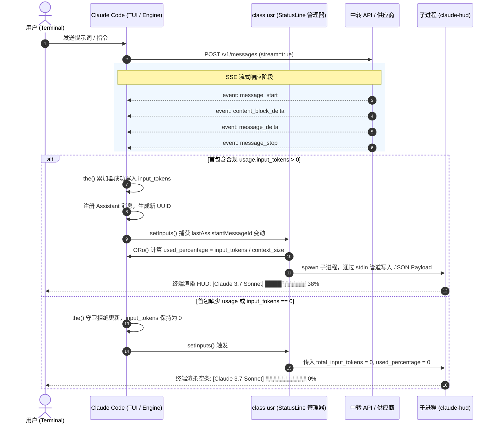

# Claude Code 终端状态栏 (Claude HUD) 激活机制与 API 协议逆向分析

> **分析对象**：
> - `Claude Code` 核心二进制 (`2.1.295`，Windows SEA 包)
> - `claude-hud` 终端状态栏插件 (`0.10.0` / `0.1.0`)
> - `cc-switch` 多供应商切换工具 (`cc-switch.db`)
> 
> **核心问题**：
> 1. 为什么使用某些中转 API 时，终端底部完全空白？
> 2. 为什么有时候状态栏出现了，但进度条死锁在 `0%`（`░░░░░░░░░░ 0%`）？
> 3. 为什么在 Windows 环境下经常遇到 Git Bash 吞反斜杠、找不到路径或语法解析错误？
> 4. 中转网关与客户端环境需要满足什么标准协议和配置才能稳定 100% 激活？

---

## 目录
- [一、 现象分类与定位矩阵](#一-现象分类与定位矩阵)
- [二、 Claude Code 状态栏生命周期逆向 (class usr)](#二-claude-code-状态栏生命周期逆向-class-usr)
- [三、 根因 1：终端底部完全空白（客户端配置丢失与覆写）](#三-根因-1终端底部完全空白客户端配置丢失与覆写)
- [四、 根因 2：进度条死锁在 0%（Token 累加器 the() 守卫截断）](#四-根因-2进度条死锁在-0token-累加器-the-守卫截断)
- [五、 根因 3：Windows Git Bash vs CMD / PowerShell 执行器差异](#五-根因-3windows-git-bash-vs-cmd--powershell-执行器差异)
- [六、 误区澄清与技术纠偏](#六-误区澄清与技术纠偏)
  - [澄清 1：isContextUnreported 隐身论的澄清](#澄清-1iscontextunreported-隐身论的澄清)
  - [纠偏 2：伪造 HTTP 响应头额度完全无效与 Lantern Wick 风险](#纠偏-2伪造-http-响应头额度完全无效与-lantern-wick-风险)
- [七、 额度看板与余额点亮最佳实践（externalUsagePath）](#七-额度看板与余额点亮最佳实践externalusagepath)
- [八、 终审结论与系统治理规范](#八-终审结论与系统治理规范)

---

## 一、 现象分类与定位矩阵

在使用中转 API 或 `cc-switch` 切换供应商时，开发者最常碰到的两类状态栏失效表现：

```text
【现象 A：终端底部完全空白】
$ claude
> 请用 Python 写一个快排算法...
(代码正常生成，但终端底部一片漆黑，没有任何状态栏、模型名或进度条)

【现象 B：状态栏出现，但进度条永远是 0%】
$ claude
> 请分析这个大型仓库并重构...
[Claude 3.7 Sonnet] ░░░░░░░░░░ 0%  (5h: --% · 7d: --%)
(会话无论多长、上下文无论多大，进度条永久锁定在 0%)
```

| 现象分类 | 表象特征 | 故障所属层级 | 根本诱因 |
| :--- | :--- | :--- | :--- |
| **现象 A** | 终端底部无任何显示 | **客户端配置层** | `~/.claude/settings.json` 缺少 `statusLine`，或被 `cc-switch` 切换时抹除，或执行器命令报错退出 |
| **现象 B** | 出现 HUD 但进度为 0% | **API 流式协议层** | 中转网关在 SSE 首包 `message_start` 中未提供 `usage.input_tokens > 0` |

---

## 二、 Claude Code 状态栏生命周期逆向 (class usr)

在反编译的 `Claude Code 2.1.295` 核心代码中，终端状态栏完全由 `class usr` 及挂载函数控制：



### 1. 调度触发与防抖核心
在 `class usr` 中：
```javascript
class usr {
  setInputs(e) {
    let n = this.#t;
    if (this.#t = e, !this.#s) return;
    let r = $Ro.some((h) => !Object.is(n[h], e[h])),
        // 核心守门：必须产生新的 Assistant 消息 ID
        s = !Object.is(n.lastAssistantMessageId, e.lastAssistantMessageId) 
            && e.lastAssistantMessageId !== this.#u;
    if (r || s) this.#y(); // 防抖调度 #w()
  }

  #w() {
    this.#i?.abort();
    let e = new AbortController;
    this.#i = e;
    let n = ei(this.#e.getMessages()), r = this.#p;
    this.#p = !1;
    let s = dsr(n); // 提取消息流中最新的 assistant 消息 UUID
    if (s !== this.#u) this.#u = s, this.#f = Pge(n);
    this.#R(e.signal, n, r, this.#f).catch(c);
  }
}
```

### 2. Payload 组装函数 `ORo` 与 `_We`
状态栏启动时，Claude Code 会构造一段包含会话运行指标的 JSON 并传入子进程的 `stdin`：
```javascript
function ORo({ session: e, messages: y, mainLoopModel: w, ... }) {
  let Ge = o0e(y);        // 向上遍历 messages 提取最近一条有效 usage
  let Qe = im(Me, Wf());  // 获取当前模型的上下文窗口大小 (如 200,000 或 1,000,000)
  let lt = G4();          // 提取当前会话 rate_limits (5h/7d 额度)
  
  return {
    model: { id: Me, display_name: zo(Me) },
    context_window: _We(Ge, Qe),
    rate_limits: ct,
    // ...
  };
}

function _We(e, n) {
  let r = wUn(e, n); // 计算占用率百分比
  return {
    total_input_tokens: e ? e.input_tokens + e.cache_creation_input_tokens + e.cache_read_input_tokens : 0,
    total_output_tokens: e?.output_tokens ?? 0,
    context_window_size: n,
    current_usage: e,
    used_percentage: r.used,
    remaining_percentage: r.remaining
  };
}
```

---

## 三、 根因 1：终端底部完全空白（客户端配置丢失与覆写）

### 1. `cc-switch` 覆盖写机制
在本地分析 `~/.cc-switch/cc-switch.db` 的 SQLite 数据库：
- 表 `providers` 保存了用户的所有供应商档案，核心字段为 `settings_config`（存储该 Provider 的完整 settings JSON）。
- 表 `settings` 保存了全局配置，如 `common_config_claude`。

**关键发现**：
- 当用户在 `cc-switch` 切换 Provider 时，`cc-switch` 会把目标 Provider 对应的 `settings_config` **全量覆盖写入** `~/.claude/settings.json`。
- 如果用户是在激活了 `claude-hud` 后，新建或导入了供应商档案，但该档案的 `settings_config` 中**未包含 `statusLine`**，那么只要一次切换，`settings.json` 中的 `statusLine` 就会被连根拔起！
- 客户端因为没有配置 `statusLine`，Claude Code 在 `Qir` 函数中：
  ```javascript
  let y = XZe(rr()?.statusLine);
  if (!y || y.type !== "command") return; // 直接跳过，不启动任何进程
  ```
  终端底部因此一片空白。

---

## 四、 根因 2：进度条死锁在 0%（Token 累加器 the() 守卫截断）

在 `claude.exe` 的流式累加模块中，负责合并 Usage 的底层函数为 `the(oldUsage, newUsage)`：

```javascript
function the(oldUsage, newUsage) {
  if (!newUsage) return { ...oldUsage };
  return {
    // 关键守卫：必须严格大于 0！
    input_tokens: newUsage.input_tokens !== null && newUsage.input_tokens > 0 
      ? newUsage.input_tokens 
      : oldUsage.input_tokens,
    output_tokens: newUsage.output_tokens ?? oldUsage.output_tokens,
    cache_creation_input_tokens: newUsage.cache_creation_input_tokens ?? oldUsage.cache_creation_input_tokens,
    cache_read_input_tokens: newUsage.cache_read_input_tokens ?? oldUsage.cache_read_input_tokens
  };
}
```

### 为什么 0% 会死锁？
1. **会话初始状态**：新一轮对话开始时，`oldUsage.input_tokens` 初始为 `0`。
2. **首包到达 (`message_start`)**：
   - 官方 Anthropic 原生 API：在 `message_start` 中立即提供真实或预估的 `usage.input_tokens`（例如 `2480`）。`2480 > 0` 守卫通过，内部状态更新为 `2480`。
   - 非规范中转 API（粗暴转译自 OpenAI `/chat/completions` 流）：
     - 首包 `message_start` 内部的 `usage` 缺失；
     - 或者首包中直接填入 `"input_tokens": 0`。
   - 由于 `0 > 0` 为假，`the()` 累加器拒绝更新，内部计数器依然是 `0`！
3. **正文流传输阶段 (`content_block_delta`)**：
   - 只传输文本 chunk，不传输 prompt usage。
4. **尾包到达 (`message_delta`)**：
   - 官方标准下，尾包只返回 `{"usage": {"output_tokens": 128}}`，不再包含 `input_tokens`。
   - 导致整个会话结束时，Claude Code 内存里的 `total_input_tokens` 永远为 `0`。
5. **HUD 接收数据**：
   - `claude-hud` 从 `stdin` 读入 `total_input_tokens = 0`，`used_percentage = 0`。
   - 最终输出灰色空条：`░░░░░░░░░░ 0%`。

---

## 五、 根因 3：Windows Git Bash vs CMD / PowerShell 执行器差异

通过对 `claude.exe` 内部执行器函数 `HF`、`oV`、`Z8` 的逆向，揭开了 Windows 平台上的重大环境差异：

```javascript
function Z8() {
  let e = Pxe();
  if (e.gitBashPath === void 0) e.gitBashPath = g();
  return e.gitBashPath;
}

function g() {
  if (process.env.CLAUDE_CODE_GIT_BASH_PATH) { ... }
  let r = ["C:\\Program Files\\Git\\bin\\bash.exe", "C:\\Program Files (x86)\\Git\\bin\\bash.exe"];
  for (let n of r) if (existsSync(n)) return n;
  let i = which("git");
  if (i) {
    let n = path.join(i, "..", "..", "bin", "bash.exe");
    if (existsSync(n)) return n;
  }
  return null;
}

function oV() {
  return Rl() ? "bash" : "powershell";
}

function Rl() {
  if (process.platform !== "win32") return true;
  return Z8() !== null;
}
```

### 1. 执行器判定分流
- **当系统安装了 Git for Windows 时**：
  `Z8()` 能定位到 `bash.exe`，因此 `Rl()` 返回 `true`，`oV()` 默认返回 `"bash"`！
  此时 Claude Code 会调用 `bash.exe -c "<command>"` 执行 `statusLine.command`。
- **当系统未安装 Git for Windows 时**：
  `Z8()` 返回 `null`，`oV()` 降级为 `"powershell"`。
  Claude Code 调用 `powershell.exe -Command "<command>"` 执行。

### 2. 反斜杠转义与语法崩溃
- **如果在 Git Bash 环境下使用了 Windows 反斜杠**：
  在 `HF` 中有这一段预处理代码：
  ```javascript
  let Ft = ct && !Tt && !Pt ? (Dr) => Dr.replaceAll("\\", "/") : (Dr) => Dr;
  ```
  如果用户在 `settings.json` 中配置了类似 `C:\Users\username\...` 的命令，当它进入 `bash.exe -c` 时：
  - 未被替换的部分会被 bash 视为转义符（例如 `\u`、`\s` 会被直接吞掉或破坏）；
  - 如果命令中使用了 Windows CMD 语法（如 `dir` 或 `cmd.exe /c`），在 Bash 下会直接报错退出。
- **如果在 PowerShell 环境下传入了 Bash 单行脚本**：
  `claude-hud` 原生默认生成的 `statusLine.command` 是类 Unix Bash 单行脚本：
  ```bash
  cols=$(stty size </dev/tty 2>/dev/null | awk '{print $2}'); export COLUMNS=$(( ... )); plugin_dir=$(...); exec node "${plugin_dir}dist/index.js"
  ```
  在没有 Git Bash 的纯 Windows 机器上，Claude Code 会使用 `powershell` 执行该字符串，直接触发致命语法错误：
  `The term 'cols=$(stty' is not recognized as the name of a cmdlet...`。

### 3. 最优跨平台解法
1. **使用正斜杠 `/`**：Node.js、PowerShell、CMD 以及 Git Bash 在处理文件路径时，全部原生支持正斜杠 `/`。
2. **使用 Node 专用分发脚本**：避免在 `command` 里塞入复杂的 Bash / PowerShell 管道语法，直接调用 `node "C:/Users/.../statusline.mjs"`。
3. **或者在 `statusLine` 配置中显式指定 `args`（Exec Form）**：
   ```json
   "statusLine": {
     "type": "command",
     "command": "node",
     "args": ["C:/Users/username/.claude/plugins/claude-hud/statusline.mjs"]
   }
   ```
   直接绕过 shell 解释器，零字符转义风险。

---

## 六、 误区澄清与技术纠偏

### 澄清 1：isContextUnreported 隐身论的澄清
早期有开发者怀疑：“是否因为 `total_input_tokens == 0` 触发了 `claude-hud` 内部的 `isContextUnreported()`，导致整个状态栏隐形隐藏？”

**逆向事实**：
- 在 `claude-hud` 源码中，`isContextUnreported(stdin)` 仅位于 `src/index.ts` 的 `needsTranscript()` 中；
- 其作用仅是在用量为 0 时，尝试去读取 `.jsonl` 历史转录本寻找 token；
- 在渲染器 `src/render/compact.ts` 和 `expanded.ts` 中，当用量为 0 时，HUD 会正常绘制出灰色空条 `░░░░░░░░░░ 0%`；
- **它绝不会导致整行空白**。整行空白的唯一原因就是 `statusLine` 根本没有被触发或子进程崩溃。

---

### 纠偏 2：伪造 HTTP 响应头额度完全无效与 Lantern Wick 风险
早期方案曾设想：在中转网关的 HTTP 响应头中注入 `anthropic-ratelimit-unified-*`（如 `5h-utilization: 0.25`）以点亮用量进度条。

**逆向结论：在第三方 API Key 场景下该方案被底层完全封死**：
```javascript
let w = bt(); // 检查是否包含 Claude.ai 网页版 OAuth 凭据 (user:sessions:claude_code)
if (!FXt(w)) { // FXt 要求必须是网页版 OAuth OR 当前显式处于 Gateway 模式
  this.rawUtilization = {}; // 强制清空全部响应头用量！
  return null;
}
```
1. **静默丢弃**：使用第三方中转（`ANTHROPIC_BASE_URL` + `ANTHROPIC_AUTH_TOKEN`）时，没有网页版 OAuth 会话，Claude Code 会强制将响应头中的 Rate-Limit 全部置空！
2. **Lantern Wick 风险**：即便通过 `CLAUDE_CODE_USE_GATEWAY=1` 强开网关模式，一旦伪造的用量大于等于 0.95，Claude Code 会进入 Lantern Wick 保护模式，向上下文注入限额警报：
   > `[Usage limit reached — grace window active. Wrap up: finish or checkpoint; don't start subagents or long work.]`
   导致模型拒绝派生子任务并立刻终止操作。

---

## 七、 额度看板与余额点亮最佳实践（externalUsagePath）

既然无法通过 HTTP 响应头安全注入额度，如何才能在 HUD 中安全点亮 `5h: xx% · 7d: xx%` 和余额呢？

`claude-hud`（`src/external-usage.ts`）原生支持 **外部用量快照机制**：

1. 创建本地用量快照文件（例如 `~/.claude/external-usage.json`）：
   ```json
   {
     "updated_at": "2026-10-09T10:00:00.000Z",
     "five_hour": {
       "used_percentage": 28.5,
       "resets_at": "2026-10-09T15:00:00.000Z"
     },
     "seven_day": {
       "used_percentage": 42.0,
       "resets_at": "2026-10-16T00:00:00.000Z"
     },
     "balance_label": "余额: $15.80"
   }
   ```
2. 在 `~/.claude/plugins/claude-hud/config.json` 中配置：
   ```json
   {
     "display": {
       "externalUsagePath": "C:/Users/username/.claude/external-usage.json"
     }
   }
   ```
3. HUD 会在每次渲染时直接加载该 JSON，渲染出精美的百分比进度条与余额状态，**100% 避开 Claude Code 响应头拦截门禁，零副作用**。

---

## 八、 终审结论与系统治理规范

1. **客户端治理**：
   - 必须在 `~/.claude/settings.json` 中配置标准 `statusLine` 命令。
   - 必须同步更新 `~/.cc-switch/cc-switch.db` 中的所有 Claude Provider 档案，避免后续切换操作覆写丢失配置。
   - 路径必须使用正斜杠 `/`，或者使用 Node 专用脚本入口。
2. **网关层治理**：
   - 代理网关在转发 SSE 流时，**必须确保首包 `message_start` 包含 `usage.input_tokens > 0`**。
   - 即使 upstream 是 OpenAI 格式，网关在首包也应通过轻量分词或字符估算填入合理的 `input_tokens`。
   - 在尾包 `message_delta` 中同样保留或修正真实的 `input_tokens`（双保救赎）。
   - 在长时间推理（长思考）期间，定期发送 `event: ping`，防止 Claude Code 30s 空闲看门狗超时掐断。
