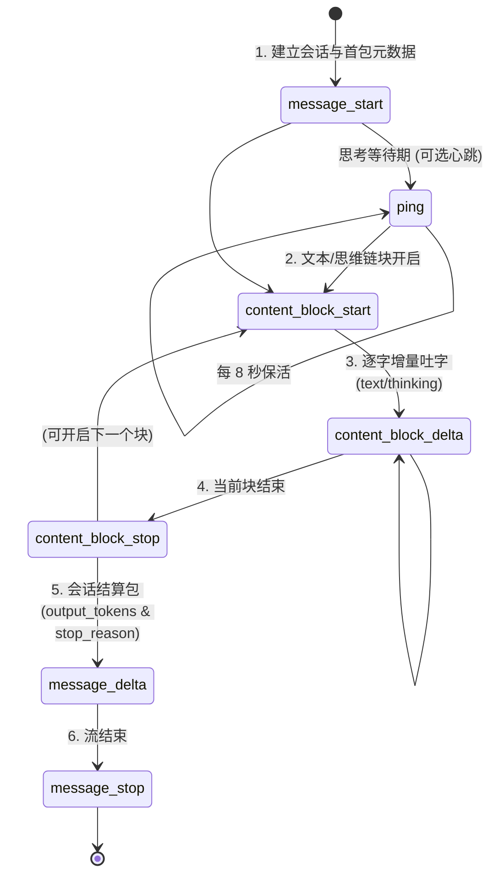

# Anthropic Messages API SSE 流式协议与网关增强规范

> **规范版本**：1.0.0  
> **适用范围**：Claude Code 客户端网关、中转 API、反向代理及流式增强中间件  
> **核心目标**：消除中转环境下 Claude HUD 进度条卡 0%、大模型长思考 30s 超时断流、以及代理缓冲导致的流卡顿等问题。

---

## 目录
- [一、 HTTP 传输层与反向代理规范](#一-http-传输层与反向代理规范)
- [二、 Anthropic 原生 SSE 事件流标准时序](#二-anthropic-原生-sse-事件流标准时序)
- [三、 首包/尾包 Token 补救机制 (双保救赎)](#三-首包尾包-token-补救机制-双保救赎)
  - [1. 为什么首包必须包含 usage.input_tokens > 0](#1-为什么首包必须包含-usageinput_tokens--0)
  - [2. 缺失 Token 时的本地轻量估算算法](#2-缺失-token-时的本地轻量估算算法)
  - [3. 尾包 message_delta 真实用量补录机制](#3-尾包-message_delta-真实用量补录机制)
- [四、 30s 看门狗与 event: ping 心跳规范](#四-30s-看门狗与-event-ping-心跳规范)
  - [1. Claude Code 内部 30 秒空闲超时机制](#1-claude-code-内部-30-秒空闲超时机制)
  - [2. 心跳事件结构与发送周期](#2-心跳事件结构与发送周期)
- [五、 Nginx 与 CDN 缓冲配置最佳实践](#五-nginx-与-cdn-缓冲配置最佳实践)
- [六、 典型完整 SSE 报文参考](#六-典型完整-sse-报文参考)

---

## 一、 HTTP 传输层与反向代理规范

任何面向 Claude Code 的 Messages API 流式端点（`POST /v1/messages` 且 `stream: true`），在建立 HTTP 连接并返回响应时，必须遵循以下响应头标准：

```http
HTTP/1.1 200 OK
Content-Type: text/event-stream; charset=utf-8
Cache-Control: no-cache, no-transform
Connection: keep-alive
X-Accel-Buffering: no
```

### 响应头释义：
1. **`Content-Type: text/event-stream; charset=utf-8`**：标准 Server-Sent Events 类型，必须带 utf-8 编码。
2. **`Cache-Control: no-cache, no-transform`**：禁止任何中间代理对数据包进行重压缩、重包装或缓存。
3. **`Connection: keep-alive`**：保持底层 TCP 长连接复用。
4. **`X-Accel-Buffering: no`**：通知 Nginx、OpenResty 等反向代理**立刻禁用代理缓冲**，收到每个 TCP chunk 立即下发到客户端，避免积攒数十 KB 才吐出首字。

---

## 二、 Anthropic 原生 SSE 事件流标准时序

Anthropic Messages API 的流式协议不是普通的原始文本流，而是一个具有严格状态机转换的事件流：



### 事件清单：
1. **`message_start`**：流的第一个事件。声明消息 ID、模型名称、角色（`assistant`）以及输入用量 `usage`。
2. **`content_block_start`**：声明新内容块索引 `index` 及类型（`text` 或 `thinking`）。
3. **`content_block_delta`**：增量内容推送（`text_delta` 或 `thinking_delta`）。
4. **`content_block_stop`**：声明当前内容块结束。
5. **`message_delta`**：流结算。携带停止原因（`end_turn`、`max_tokens`、`stop_sequence` 等）以及输出 Token 统计 `usage.output_tokens`。
6. **`message_stop`**：流终止符。
7. **`ping`**：长连接心跳保活帧。

---

## 三、 首包/尾包 Token 补救机制 (双保救赎)

### 1. 为什么首包必须包含 `usage.input_tokens > 0`
在 Claude Code 二进制中，Token 累加器实现为：
```javascript
function the(oldUsage, newUsage) {
  if (!newUsage) return { ...oldUsage };
  return {
    input_tokens: newUsage.input_tokens !== null && newUsage.input_tokens > 0 
      ? newUsage.input_tokens 
      : oldUsage.input_tokens,
    output_tokens: newUsage.output_tokens ?? oldUsage.output_tokens,
    // ...
  };
}
```
- 会话初始时 `oldUsage.input_tokens = 0`。
- 如果上游在 `message_start` 中未提供 `usage`，或给出了 `input_tokens: 0`，由于 `input_tokens > 0` 守卫失败，`oldUsage.input_tokens` 仍然为 `0`。
- 随后客户端向状态栏传参 `total_input_tokens = 0`，状态栏进度条永远显示 `0%`。

### 2. 缺失 Token 时的本地轻量估算算法
很多中转 API 底层对接的是 OpenAI 兼容格式（如 `/chat/completions`）。OpenAI 官方流在开始时**不返回 Prompt Tokens**，直到整个流结束的最后一个 chunk 才返回 `usage`。

**网关解决方案**：
在收到客户端的请求体（包含 `system`、`messages` 等）后，在下发首包 `message_start` 前，本地进行快速 Token 估算：

```javascript
export function estimateTokens(payload) {
  if (!payload) return 100;
  let chars = 0;
  
  // 1. 统计 system prompt
  if (typeof payload.system === 'string') {
    chars += payload.system.length;
  } else if (Array.isArray(payload.system)) {
    for (const item of payload.system) {
      if (typeof item === 'string') chars += item.length;
      else if (item?.text) chars += item.text.length;
    }
  }

  // 2. 统计 messages
  if (Array.isArray(payload.messages)) {
    for (const msg of payload.messages) {
      if (typeof msg.content === 'string') {
        chars += msg.content.length;
      } else if (Array.isArray(msg.content)) {
        for (const block of msg.content) {
          if (block.type === 'text' && typeof block.text === 'string') {
            chars += block.text.length;
          }
        }
      }
    }
  }

  // 3. 统计 tools / functions 定义
  if (Array.isArray(payload.tools)) {
    chars += JSON.stringify(payload.tools).length;
  }

  // 启发式加权：混合中英双语与代码环境
  // 英文约 4 字符/Token，中文约 1.5 字符/Token，加权平均取 ~2.5 字符/Token
  const estimated = Math.max(10, Math.ceil(chars / 2.5));
  return estimated;
}
```

### 3. 尾包 `message_delta` 真实用量补录机制
Claude Code 的流解析器在收到 `message_delta` 时，内置了用量补录通道：
```javascript
case "message_delta":
  if (n.usage.input_tokens != null) s.usage.input_tokens = n.usage.input_tokens;
```
**网关双保策略**：
1. **首包注入**：若上游首包缺少 `input_tokens` 或值为 0，网关直接注入预估的 `input_tokens`，**确保 HUD 第一时间点亮**。
2. **尾包补录**：在上游发出尾包时，若上游携带了真实精确的 `input_tokens`，网关确保将其带在 `message_delta.usage` 中透传给客户端，客户端会自动纠偏为真实值。
3. **缓存用量透传**：透传 `cache_creation_input_tokens` 与 `cache_read_input_tokens`，确保 Claude HUD 正确计算 Prompt Caching 节省率。

---

## 四、 30s 看门狗与 `event: ping` 心跳规范

### 1. Claude Code 内部 30 秒空闲超时机制
Claude Code 在读取 SSE 流时设定了内置看门狗：
```javascript
const Jk = 30000; // 30 秒超时时间
```
当向中转发送请求后，如果网络延迟大、排队拥堵、或者模型进入深度思考（如 DeepSeek-R1、OpenAI o1/o3-mini 长达 40~90 秒未吐出第一个文字 chunk），Claude Code 会认为连接已僵死，主动抛出异常：
```text
Streaming idle timeout: No data received within 30000ms
```
随后会话中断崩溃。

### 2. 心跳事件结构与发送周期
Anthropic SSE 协议原生预留了 `ping` 事件：
```sse
event: ping
data: {"type": "ping"}

```
- **发送周期建议**：在等待首个内容包期间，若超过 **8 秒** 未收到上游数据，网关每隔 **8~10 秒** 向客户端下发一次 `ping` 心跳。
- **作用**：Claude Code 在收到任何合规的 SSE 数据帧（包括 `ping`）后，会重置其内部的 30 秒看门狗定时器，从而完美支持 1~5 分钟的超长思考模型。
- **停止心跳**：一旦上游开始吐出 `content_block_delta`，网关即可停止周期心跳，恢复透明直通流。

---

## 五、 Nginx 与 CDN 缓冲配置最佳实践

如果网关前端挂载了 Nginx、OpenResty、Traefik 或 Cloudflare：

### 1. Nginx 配置
```nginx
location /v1/messages {
    proxy_pass http://127.0.0.1:8080;
    
    # 禁用响应缓冲
    proxy_buffering off;
    proxy_cache off;
    
    # 允许分块传输编码
    chunked_transfer_encoding on;
    
    # 超时保护 (设置至少 10 分钟以支持长推理)
    proxy_read_timeout 600s;
    proxy_send_timeout 600s;
    
    # 传递必要头
    proxy_set_header Host $host;
    proxy_set_header X-Real-IP $remote_addr;
    proxy_set_header X-Forwarded-For $proxy_add_x_forwarded_for;
    proxy_set_header Connection '';
    proxy_http_version 1.1;
}
```

### 2. Cloudflare CDN 注意事项
- 在 Cloudflare 仪表盘中，针对 `/v1/messages` 路由添加 Cache Rule，设置为 **Bypass Cache**。
- 关闭 Rocket Loader 与 HTML/JSON 压缩微调（Auto Minify），避免破坏 SSE 格式。

---

## 六、 典型完整 SSE 报文参考

一个 100% 满足 Claude Code 与 Claude HUD 的标准流示例如下：

```sse
event: message_start
data: {"type":"message_start","message":{"id":"msg_01Abcdef1234567890","type":"message","role":"assistant","model":"claude-3-7-sonnet","content":[],"stop_reason":null,"stop_sequence":null,"usage":{"input_tokens":1850,"cache_creation_input_tokens":0,"cache_read_input_tokens":0}}}

event: ping
data: {"type":"ping"}

event: content_block_start
data: {"type":"content_block_start","index":0,"content_block":{"type":"text","text":""}}

event: content_block_delta
data: {"type":"content_block_delta","index":0,"delta":{"type":"text_delta","text":"你好！"}}

event: content_block_delta
data: {"type":"content_block_delta","index":0,"delta":{"type":"text_delta","text":"我是 Claude。有什么我可以帮你的吗？"}}

event: content_block_stop
data: {"type":"content_block_stop","index":0}

event: message_delta
data: {"type":"message_delta","delta":{"stop_reason":"end_turn","stop_sequence":null},"usage":{"input_tokens":1850,"output_tokens":22}}

event: message_stop
data: {"type":"message_stop"}

```
> **注意**：每一组 SSE 事件末尾必须有连续的两个换行符 `\n\n`，以符合 RFC 8895 规范。
